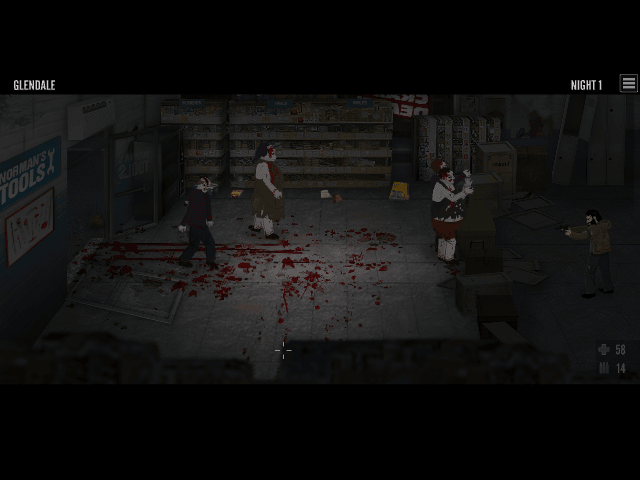

# The Last Stand Legacy Collection for PortMaster (test fixes)

Fixes and test results for the PortMaster port of [The Last Stand Legacy Collection](https://store.steampowered.com/app/1615100/) by thelaggypyro. The port runs the original Flash games with Ruffle (`ruffle_sdl`). This repository holds the fixed port zip (as a release), the changes made to it, and the notes for the port author. No game files are included: you need your own copy of the game.

## Download and install

1. Download `laststand.zip` from the [latest release](https://github.com/crxssrazr93/laststand-test/releases/latest).
2. Unzip it into your `ports` folder (or install it with PortMaster's local install).
3. Open the game's install folder on your PC (Steam, Manage, Browse local files) and copy everything into `ports/laststand/gamedata/`. You should see `TheLastStandLegacyCollection.swf` and the folder `gamefiles`.
4. Start "The Last Stand Collection" from the Ports menu.

On 1 GB devices turn on zram or swap in the firmware settings. Union City uses about 415 MB.

## What was wrong

* **No visible pointer.** The collection menu and all three games are driven by the mouse. `ruffle_sdl` hides the system cursor, so on handhelds without a touch screen the pointer moved but could not be seen, and testers could not get past the main screen.
* **The Last Stand 2 drew a black screen** on the Mali GPU while the game ran underneath.
* **The pointer was slow** on large screens (about 8 seconds to cross a 1080p screen) and started in the top left corner.
* **A red debug log** could appear over the menu when a game loaded.
* **The Steam file was changed in place** on every start.
* **The controls table** did not match the button mapping.

## What this build changes

* `ruffle_sdl` is rebuilt for aarch64 with a software cursor patch ([`ruffle-patch/`](ruffle-patch)). The arrow works in the menu and in all three games, starts in the middle of the screen, and hides after two seconds without moving.
* Pointer speed scales with the screen width: about 1.5 seconds to cross the screen on any device.
* The launcher sets `RUFFLE_EMPTY_TEXTURES=0`, which fixes the black screen in The Last Stand 2.
* The menu patches (render scale, no debug log) are applied to a copy, with the original kept as `.orig`, and only to the known Steam version of the file.
* The author's own menu arrow is used only when the port's pointer is turned off, so there are never two arrows.
* Correct controls table, cover, screenshot, `port.json` and `gameinfo.xml`.

Everything from the author's zip of 14 October is kept (menu arrow patch, `.orig` copy, gptokeyb2 support).

## Controls

| Button | Action |
|---|---|
| D-pad / left stick | Move (W A S D) |
| Right stick | Mouse pointer and aim |
| R1 / R2 | Left click / right click |
| A | Space (switch weapon) |
| B | R (reload) |
| X | Esc (options) |
| Y | Shift |
| L1 | E |
| L2 | N |
| Start | Space |
| Select + Start | Quit |

Buttons are named by position: A is the bottom button.

## Settings

Edit `ports/laststand/laststand.cfg`:

| Setting | Default | What it does |
|---|---|---|
| `LS_QUALITY` | `low` | Ruffle render quality: low, medium, high |
| `LS_RENDER_SIZE` | `640x480` | Size the game is drawn at before scaling to the screen |
| `LS_NATIVE_CURSOR` | `on` | The port's pointer arrow in every game |
| `LS_MOUSE_SPEED` | `100` | Pointer speed in percent |
| `LS_CURSOR_IDLE_MS` | `2000` | Hide the arrow after this many milliseconds without moving |
| `LS_CURSOR_SIZE` | empty | Arrow height in pixels (empty means one 20th of the screen height) |
| `LS_SOFT_CURSOR` | `auto` | The menu's own arrow, used only when `LS_NATIVE_CURSOR` is off |

## Test status

Tested on an Anbernic RG35XX H with Knulli, installed from the release zip with a fresh Steam copy.

| | Result | Peak memory |
|---|---|---|
| Collection menu | Works with the pad only | 205 MB |
| The Last Stand | Starts and plays | 299 MB |
| The Last Stand 2 | Intro, diary and first night played | 382 MB |
| Union City | Starts and plays | 414 MB |

Not checked yet: Select + Start exit in every game, frame rate, audio and saves per game, every button in the table, pointer speed with classic gptokeyb, a stretch to fill option for 4:3 screens, and muOS, ROCKNIX and dArkOS. Reports from other devices are welcome: please include `ports/laststand/log.txt`.

## Repository contents

| Path | What it is |
|---|---|
| [`FEEDBACK.md`](FEEDBACK.md) | Detailed findings and fixes for the port author |
| [`ruffle-patch/`](ruffle-patch) | Software cursor patch for `ruffle_sdl` |
| [`tests/`](tests) | Scripts used to drive and check the port on a device |

## Credits

The Last Stand games by Con Artist Games, collection by Armor Games Studios. Port by thelaggypyro. [Ruffle](https://ruffle.rs) by the Ruffle team (MIT and Apache 2.0), SDL front end by Knifethrower.
